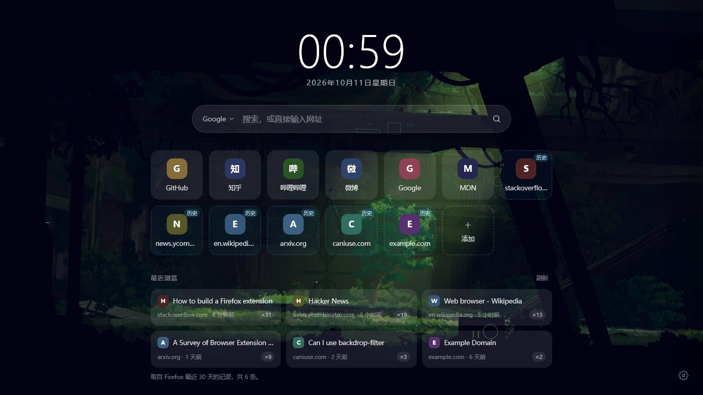
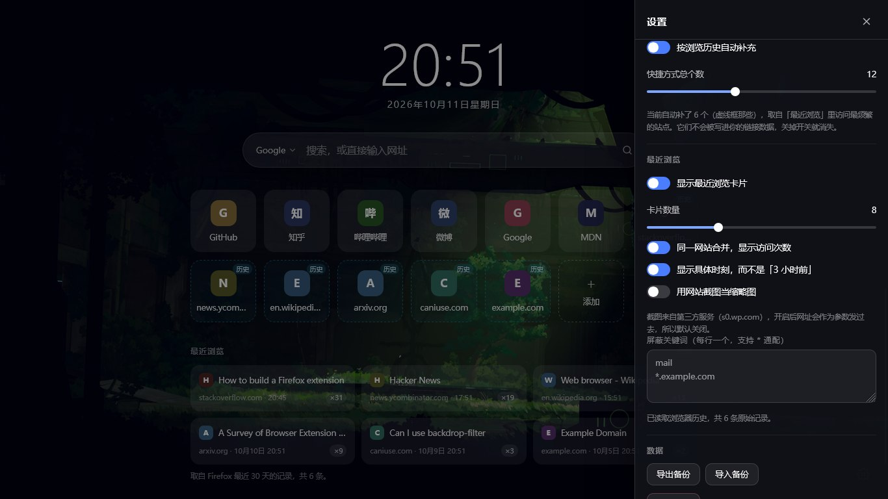
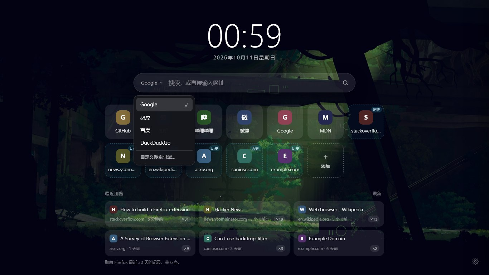

# FoxHome

> 把 Firefox 的新标签页和主页换成你自己的起始页：自定义背景、多引擎搜索、快捷方式、最近浏览 —— 全部数据只留在这台电脑上。

> 背景为自定壁纸；链接与历史用的是示例数据。

做成一个本地扩展，**装上新标签页就是它**。页面本身是纯静态 HTML/CSS/JS：没有依赖、没有构建步骤、完全离线可用。

## ✨ 功能

- 🖼️ **自定义背景** —— 6 套内置渐变/纯色，也可以上传自己的图片（直接把图拖到页面上也行），带遮罩调节，想暗一点让文字更清楚就拉滑块
- 🔍 **搜索** —— 内置 Google / 必应 / 百度 / DuckDuckGo；输入 `github.com` 这样的网址会直接跳转，而不是拿去搜索
- 🎛️ **搜索引擎可自定义** —— 增、删、改都行，只要填一个带 `%s` 的搜索地址，本地自建的搜索服务也能加
- 🧩 **快捷方式** —— 手动增删改、拖拽排序；还会按浏览历史**自动补充**常访问的站点，总个数可设
- 🕘 **最近浏览** —— 把真实历史做成卡片，可设数量、同域名合并显示访问次数、按关键词屏蔽；默认不联网
- 🕐 **时钟与日期** —— 不抢眼，可以关掉
- ⌨️ **键盘优先** —— `/` 或 `Ctrl+K` 直接聚焦搜索框，回车就走
- 🔒 **数据不出本机** —— 只申请 `history` 一项权限，没有后台脚本、没有消息通道、没有遥测

## 📥 安装

扩展已经发布在 [Firefox 附加组件网站](https://addons.mozilla.org/firefox/)，搜 **FoxHome** 安装即可。

也可以从文件装：`about:addons` → 右上角齿轮 → **「从文件安装附加组件…」** → 选签名好的 `.xpi`。装完**重启 Firefox 也不会失效**。

装好之后**什么都不用设置**：

- **新标签页**（`Ctrl+T`）—— 打开的就是它
- **主页 / 新窗口** —— 启动时打开的也是它

> 安装时 Firefox 会提示"扩展想要更改你的主页"，同意即可，这是这类覆盖的常规提示。随时能在 `about:preferences#home` 里改回去。
>
> 如果你以前手动把主页填成了 `file:///...` 之类的路径，建议恢复成「Firefox 主页」—— 手动那份会被扩展的声明盖过，留着容易看糊涂。

**已知限制**：启动时 Firefox 有可能在扩展加载完成之前就去取主页，出现**一瞬间的空白页**，按 `Ctrl+T` 就回到起始页。这是 Firefox 的启动时序问题，不影响新标签页。

## 🚀 使用

| 操作 | 怎么做 |
| --- | --- |
| 搜索 | 输入关键词回车，用当前选中的引擎 |
| 打开网址 | 直接输入 `github.com`、`localhost:3000` 这类地址会直接跳转 |
| 换搜索引擎 | 点搜索框左边的引擎名字，选一个（会记住） |
| 管理搜索引擎 | 同一个菜单里的「自定义搜索引擎…」，或齿轮 → 「搜索引擎」 |
| 加链接 | 点快捷方式区最后的「+ 添加」，填名称（可留空，自动用域名）和网址 |
| 改 / 删链接 | 鼠标移到快捷方式上，右上角出现铅笔和垃圾桶按钮 |
| 调整顺序 | 直接拖拽卡片到目标位置 |
| 换背景 | 右下角齿轮 → 「背景」里点色卡，或「选择本地图片」 |
| 调暗背景 | 齿轮 → 「背景遮罩」滑块，往右更暗、文字更清楚 |
| 刷新历史 | 「最近浏览」标题右侧的「刷新」 |
| 备份 / 恢复 | 齿轮 → 「导出备份」下载 JSON；「导入备份」选之前的文件；「恢复默认」清空一切 |

设置项都收在右下角的齿轮里：

### 🎛️ 搜索引擎

搜索框左边显示的是**当前引擎**，点它就能换，选择会记住：

菜单最下面的「自定义搜索引擎…」直接跳到设置里的这一区。想加自己的：齿轮 → 「搜索引擎」→「添加搜索引擎」，只填两样：

| 字段 | 说明 |
| --- | --- |
| 名称 | 菜单里显示的名字，最长 20 字 |
| 搜索地址 | 带 `%s` 的网址 —— `%s` 就是关键词要放的位置 |

`%s` 放哪儿由你定：

- `https://example.com/search?q=%s` —— 最常见的形式
- `https://example.com/s?wd=%s&ie=utf-8` —— 夹在中间也行
- `https://%s.example.com/` —— 放在域名里（少见，但合法）

列表里**点名字**就切为当前引擎，右侧「编辑」改名或改地址，「删除」移除。**至少要留一个**，所以只剩一个时删除按钮是灰的；最多 12 个。

> 也允许 `http://` —— 本地自建的搜索服务（比如 `http://127.0.0.1:8080/?q=%s`）同样能用。

### 🧩 快捷方式区

搜索框下面那排分两种：

| 位置 | 来源 | 能做什么 |
| --- | --- | --- |
| 前面几张 | 你手动添加的 | 改名、删除、拖拽排序 |
| 后面几张 | 按浏览历史自动补的（虚框 + 青色描边 +「历史」角标） | 只读，点开即用 |

自动补充的几个要点：

- **不落库**：每次渲染现算，**不写进你的链接数据** —— 关掉开关立刻恢复原样，「导出备份」里也不会带上它们，不会出现"删掉了下次又冒出来"。
- **怎么挑**：沿用「最近浏览」那套过滤（屏蔽词、同域名合并、只保留 http(s)），**排掉你已经手动加过的站点**，剩下的按最近 30 天的访问次数从高到低取，同频次看谁更近。
- **数量**：齿轮 →「快捷方式」里设**总个数**（手动 + 自动，1~30，默认 12）。手动链接已经占满总数时就不再补。
- **和「最近浏览」相互独立**：关掉历史卡片不影响快捷方式补充；反过来关掉自动补充，历史卡片照常显示。

### 🕘 最近浏览

| 设置 | 说明 |
| --- | --- |
| 显示最近浏览卡片 | 总开关，关掉则整块隐藏（也不会去读历史） |
| 卡片数量 | 1 ~ 24 张，默认 8 张 |
| 同一网站合并，显示访问次数 | 同域名只留一张卡（取最近访问的那条），右下角显示累计访问次数 |
| 显示具体时刻，而不是「3 小时前」 | 默认按相对时间显示；打开后改成具体时刻 —— 今天的只显示 `08:31`，今年更早的显示 `10月9日 20:37`，跨年的带上年份 |
| 用网站截图当缩略图 | 默认**关闭**。开启后会向第三方服务 `s0.wp.com` 请求缩略图，**网址会作为参数发给它**；首次请求对方可能还在生成，显示为空白，稍后刷新即可，失败会自动退回纯文字卡片 |
| 屏蔽关键词 | 每行一个，支持 `*` 通配。匹配范围是网址 + 标题 + 域名，命中就整条丢掉 |

屏蔽词的实际语义：

- 不写 `*` 时按「包含」匹配 —— 写 `mail` 就能挡掉 `mail.qq.com`、`gmail.com`
- 写 `*` 时星号是通配，但**仍然不要求从头匹配** —— `mail.*`、`*.example.com` 都符合直觉

查询范围固定为**最近 30 天**。

### ⌨️ 快捷键

| 键 | 作用 |
| --- | --- |
| `/` | 聚焦搜索框 |
| `Ctrl` + `K` | 同上 |
| `Esc` | 关闭面板/对话框，或让搜索框失焦 |
| `Enter` | 搜索或打开网址 |

## 🔐 数据与隐私

所有设置和链接都存在 **这台电脑上的浏览器本地存储**里（localStorage，键名 `foxhome.v1`），不会上传到任何地方。浏览历史本身不落盘，每次现读现用。

扩展只申请了 `history` 一项权限（Firefox 会明确提示），它只用于「最近浏览」卡片和快捷方式的自动补充，读到的数据在本机渲染、不外传。除了那个**默认关闭**的截图开关（会把网址发给 `s0.wp.com`），没有任何网络请求。

需要留意：

- **数据存在扩展自己的来源下**（`moz-extension://…`），所以跟项目放在哪个目录、文件夹叫什么名字都无关 —— 挪动、改名都不会丢数据。但**卸载扩展会连数据一起清掉**，所以建议偶尔「导出备份」。
- 清理浏览数据（勾选了「网站数据 / 离线缓存」）、换浏览器、换电脑，同样会丢。
- 上传的背景图片会被压缩（长边最多 2560px，转 JPEG）后以 base64 存在同一处，只保留最近一张；不需要了可以在设置里「移除图片」。
- 本地存储总量约 5 MB，所以超大背景图会被压到 1.4M 字符以内；如果还放不下，页面会给出提示。

## 🎨 按自己的口味改默认值

打开 `extension/assets/core.js`，顶部几处常量就是所有可定制项，改完刷新页面即可生效：

| 常量 | 作用 |
| --- | --- |
| `ENGINES` | **首次打开时**的默认引擎列表；之后增删改都在设置面板里，存的是 `data.search.engines` |
| `PRESETS` | 内置背景，`css` 直接写 CSS 的 `background` 值，渐变或纯色都行 |
| `DEFAULT_LINKS` | 首次打开时的默认快捷方式（只影响没数据时的初始状态） |
| `DEFAULT_OVERLAY` | 背景遮罩的默认强度，`0 ~ 0.8` |
| `HISTORY_DAYS` / `HISTORY_DEFAULT_COUNT` / `HISTORY_MAX_COUNT` | 历史查询天数、默认卡片数、卡片数上限 |
| `SHORTCUT_DEFAULT_TOTAL` / `SHORTCUT_MIN_TOTAL` / `SHORTCUT_MAX_TOTAL` | 快捷方式总个数的默认值与可调范围 |
| `MAX_ENGINES` / `MAX_ENGINE_NAME` | 自定义引擎的个数上限、名称长度上限 |
| `STORAGE_KEY` | 本地存储键名，改掉等于换一份干净的数据 |

样式集中在 `extension/assets/styles.css`，颜色、圆角、模糊强度都在文件开头的 `:root` 变量里，比如想让整体更透亮，调 `--glass` 和 `--veil` 即可。

## ❓ 常见问题

**按 `Ctrl+T` 还是 Firefox 的默认页？**
依次确认：扩展在 `about:addons` 里是**已启用**状态；没有装其它接管新标签页的扩展（比如 New Tab Override —— 多个扩展抢新标签页时 **Firefox 是"先运行的那个赢"**，和我们相反，而且它默认关闭其实不生效，禁用或卸载它即可）；`about:debugging` 里 FoxHome 没有报错。改完记得开一个新标签页验证。

**启动浏览器还是默认页？**
按顺序查：

- **「常规」面板里勾着「打开上次的窗口和标签页」** → 它和主页设置写的是同一个 `browser.startup.page`，勾上后恒为 `3`，主页被覆盖。取消勾选
- **启动瞬间闪一下空白页，然后才是（或不是）页面** → 就是上面说的启动时序问题，按 `Ctrl+T` 即可
- **以上都不是** → 到 `about:preferences#home` 看一眼「主页」那一栏是不是被别的设置占了

**「最近浏览」显示读不到历史？**
正常情况下新标签页和主页都能读到。如果出现这个提示：

- **确认你是通过扩展打开这个页面的**（按 `Ctrl+T`，或用工具栏的主页按钮）。如果直接用 `file://` 路径打开这个 HTML 文件，浏览器不允许页面读历史 —— 这是安全边界，不是 bug。
- **在扩展接管的新标签页里仍读不到**：说明没拿到 `history` 权限。去 `about:debugging` → FoxHome → 「检查」看控制台报错，或在 `about:addons` 里确认权限没被关掉。

**自定义的搜索引擎没生效？**
八成是搜索地址里漏了 `%s`，或者不是以 `http://` / `https://` 开头 —— 保存时会直接提示，不会静默失败。`%s` 就是这个关键词要替换进去的位置，漏了的话关键词没地方放。

**图标有的是彩色，有的是字母方块？**
卡片会尝试加载 `网站域名/favicon.ico`，需要联网。取不到（或站点没放这个文件）就退回「首字母 + 按域名生成的配色色块」，属于正常回退。不想要网站图标可以在设置里关掉；打开新标签页的瞬间也是先显示色块、稍后才换成网站图标。

**输入了网址却被拿去搜索了？**
只有看起来确实是网址的输入才会直接跳转：带点的域名、`localhost`、IP、或者 `http(s)://` 开头。含空格、或者带 `:` 但不是 `host:port` 形式的内容一律当搜索词（这样 `javascript:` 之类的伪协议不可能被当成地址打开）。

**开了截图缩略图，卡片是空白？**
`s0.wp.com` 首次遇到一个网址时需要现生成缩略图（几秒到几十秒），期间返回的是空白图；过一会儿刷新就好，生成过的会缓存。如果站点禁止被截图，就会一直是空白 —— 此时建议关掉这个开关。注意开启后每次都会把你的网址发给这个第三方服务。

**换电脑怎么迁移？**
旧电脑上「导出备份」，把 JSON 拷到新电脑；新电脑打开页面 → 齿轮 → 「导入备份」。背景图片会一起打包在 JSON 里，所以备份文件可能比较大，属正常。扩展需要在每台电脑上分别装。

## 📄 许可

[GPL-3.0](LICENSE)

## 🔧 开发

想改代码、跑测试、打扩展包、发布到 AMO、重新生成图标，看 [DEVELOPING.md](DEVELOPING.md)；
提交信息的格式约定看 [CONTRIBUTING.md](CONTRIBUTING.md)。
